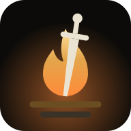

<p align="center">
  
</p>

<h1 align="center">Savepoint</h1>

<p align="center">
  A self-hosted game library and achievement tracker.<br />
  Every game you own, and every achievement in it, on your own server.
</p>

---

> **Status: v0.1.** Steam library and achievements, games from any platform with checklists,
> the Ember look. See the [roadmap](#roadmap).

## Features

- **Steam import in one step**: paste your profile link and every game you own arrives with its
  playtime, achievements, unlock dates and global rarity. Your public wishlist comes too.
- **Kept in sync**: games played in the last two weeks are checked every 15 minutes, the whole
  library every night. Unlocks and resets on Steam are mirrored.
- **Statuses that fit games**: Playing, Backlog, Beaten, On hold, Abandoned, Wishlist. Imported
  games you've played land in **Unsorted**, with one-tap buttons to sort them. 100% is tracked
  apart from Beaten.
- **The Bonfire** (home): the game you're playing and what's left to unlock (most common first),
  games closest to 100%, recent unlocks.
- **Game pages**: achievements locked first, with rarity, unlock dates, hidden ones blurred until
  you tap **Reveal**, a per-game sync button, notes and a rating.
- **Any platform**: add Switch, PlayStation or retro games from search (IGDB) or by hand. A game on
  Steam that you play elsewhere uses Steam's achievement list, ticked by you.
- **Collections and DLC split into games**: Kingdom Hearts 1.5+2.5 as four progress bars. Groups
  are suggested from the achievements' API names; rules and a few taps place the rest; a split can
  be shared as a file ([guide](docs/bundles.md)).
- **Checklists**: your own 100% beyond achievements (every boss, every ending), counted in the
  completion and shared with everyone who has the game.
- **Perfection achieved**: a 100% gets a full-screen moment once, a gold frame in the library and
  a place in the **Hall of Fame** with its rarest achievement.
- **Stats**: perfect games, average completion, unlocks per month, completion bands, rarest
  unlocks, most played.
- **Notifications** on your phone (ntfy) or Discord when you unlock achievements.
- **Household accounts**, each with its own Steam link. **Installable app** (PWA) over Tailscale
  HTTPS. **Nightly backups** of the single SQLite file.

The look ("Ember") is FromSoftware-inspired: dark stone, ash text, ember gold, engraved capitals.

## Quick start

You need Docker and a free [Steam Web API key](docs/api-keys.md).

```bash
mkdir savepoint && cd savepoint
curl -fsSLO https://raw.githubusercontent.com/Witaek/savepoint/main/docker-compose.yml
curl -fsSL https://raw.githubusercontent.com/Witaek/savepoint/main/.env.example -o .env
```

Edit `.env`: set `STEAM_API_KEY` and, if you're not on CasaOS, `DATA_DIR=./data`. Then
`docker compose up -d` and open `http://<your-server>:8788`.

## Documentation

| Guide                                           | What it covers                                                 |
| ----------------------------------------------- | -------------------------------------------------------------- |
| [Getting API keys](docs/api-keys.md)            | Steam Web API key, Steam privacy settings, IGDB (optional)     |
| [Deploying on CasaOS](docs/deploy-casaos.md)    | Installing from the CasaOS dashboard, next to Episodic         |
| [HTTPS with Tailscale](docs/https-tailscale.md) | `https://…ts.net:8443` and installing the app on your phone    |
| [Collections and DLC](docs/bundles.md)          | Splitting a game into games or DLC, each with its own progress |
| [Configuration](docs/configuration.md)          | Every environment variable and background job                  |
| [Architecture](docs/architecture.md)            | Data model, Steam sync, pages                                  |
| [Development](docs/development.md)              | Running from source with a mock Steam API, tests, releasing    |

## Roadmap

- [x] **0.1**: Steam library and achievements, sync, any-platform games, checklists, Hall of Fame,
      stats, notifications, Ember look
- [x] **Collections and DLC split into games**: groups with their own progress, rules on API
      names, order or words, moves by hand, suggestions, split files (shipped splits welcome)
- [ ] **Hunting tools**: missable flags, pinned targets, HowLongToBeat time to 100%
- [ ] **Wishlist prices**: IsThereAnyDeal alerts, release calendar
- [ ] **More platforms**: RetroAchievements, PlayStation trophies, Xbox
- [ ] **Pixel theme** (16-bit menus), as an alternative to Ember

## Credits

Game data from the [Steam Web API](https://steamcommunity.com/dev) and [IGDB](https://www.igdb.com).
Savepoint is not affiliated with Valve, Twitch, FromSoftware or Bandai Namco.
